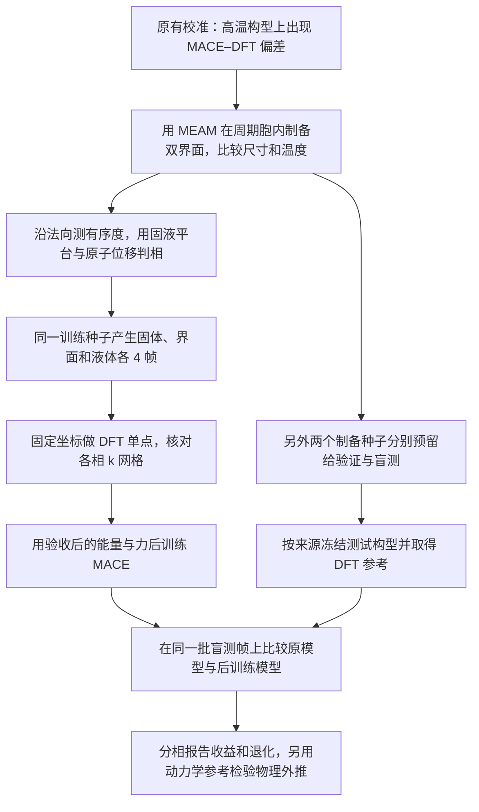

# 用传统势两相构型后训练 MACE，检验 ZrC 熔化区的能量与原子力

**论文问题**　在化学计量 ZrC 中，给预训练 MACE 补充少量由传统势两相法生成、经 DFT 标注的构型，能否改善它对独立固液界面和近熔点液体的能量与力预测，同时保持对高温固体的精度？

## 新稿从哪里接上原项目

原项目用固定权重的 MACE-MH-1（`omat_pbe`）做宽温区定体积采样。在 18 个 64 原子校准构型上，已比较 MACE 与 DFT 的能量、力和应力，并核对了每帧的两种 k 网格。部分高温帧的模型偏差超过网格引入的差异。当构型明确含有液体或固液界面时，偏差集中在哪里？旧库为这个问题提供了基线模型、DFT 口径和误差分析方法。[原项目设计](../experiment-plan.md) · [18 帧 DFT 与 MACE 对照](../../dft/reviews/dft600-k67-20261008/report.md)

模型自采样可能遗漏其难以访问的局部环境。一次 DFT 单点给出所选电子结构近似下该组坐标的能量与力，候选库覆盖哪些局部环境则取决于取样路径。新稿把固体与液体放进同一个原生周期胞，用 Ouyang Zr–C MEAM 独立生成界面，再让模型在同一批 DFT 参考坐标上接受前后对照。旧项目的 MACE 自采样帧用于研究背景，本次后训练的全部新增训练构型均取自 MEAM 两相轨迹。

## 文章怎样展开

| 论文段落 | 用什么证据回答 |
| --- | --- |
| 1. 为什么另找采样来源？ | 从原有校准展示模型偏差与 DFT 数值差异的量级，说明旧数据在哪些温度、体积与构型来源上给出了证据。模型在 ZrC 熔化区的适用范围仍是待检验问题。 |
| 2. 怎样在可标注的小胞中辨认界面？ | 比较原生大小胞的法向有序度剖面、两侧平台宽度、局部配位和界面随时间的存续。保留 256 原子的周期晶胞、盒形和全部原子，把同温大胞的相同面积窗口作为局部结构对照。 |
| 3. 为什么选这三个温度？ | 在固定面内尺寸、控制法向压力的 256 原子胞中，两个独立种子在 3200 K 均固化，在 3290 K 均液化，在 3250 K 分别走向液化和固化。由此把 3250 K 用作寻找界面帧的工作温度，再按每帧结构确认相态。 |
| 4. 增加十二个构型，改善出现在哪里？ | 以同一预训练权重为起点，比较原模型与后训练模型对相同留出构型的预测。主要结果为分相的每原子能量误差、Zr/C 力分量误差，以及界面带内原子的力误差。同步报告固相精度变化。 |

## 已经取得的构型证据

训练种子 43719 的三条轨迹共用同一份 256 原子双界面母帧。三个目标温度分别运行 120 ps。固态和液态样本来自该母帧分别固化和液化后的片段。用 Zr 局域有序参数沿法向的剖面判别固体、液体和两侧过渡带，并用 Zr/C 的 5 ps 均方位移核对纯相归属。四个界面帧的固态长度占比为 0.378–0.650，涵盖了液相较多、两相接近各半与固相较多的界面。这里的占比按法向长度计算。

按 2026-11-23 的提交记录，固相、界面、液相各有 4 个训练候选。12 帧分别提交了工作网格单点，各相另选 1 帧加密网格复算，总共 15 个 DFT 单点。训练效果需等待参考标签验收和独立评估。[逐帧清单](cohort.csv) · [计算方案](protocol.md) · [固定输入](inputs/README.md)

## 什么结果能支持论文结论

- **先量出原模型在何处有偏差。** 在相同盲测帧上比较模型与 DFT，报告每个相态的帧数、逐帧误差和分元素的力误差。对于界面单列由局域有序度识别的界面带，防止少数界面原子的误差被整胞平均稀释。能量比较说明参考零点，任何零点拟合只用训练侧数据。
- **再判断改进是否跨越训练轨迹。** 开发种子 43719、验证种子 81563、盲测种子 96827 各自连同母帧及其后代归入同一组。盲测侧的 MEAM 结构演化已用于选取工作温区，预留的是该组的 DFT 标签和模型误差。模型与参数选择在验证侧完成，最终在固定盲测帧上给出同帧前后误差之差，并与 k 网格产生的差异比较。每相报告有效轨迹数，因为同条轨迹内的多帧共享历史。
- **让结论与证据范围一致。** 若改善只出现在被标注的训练母轨迹，结论限于对该轨迹的拟合。若留出轨迹上的界面和液相也改善，可报告对该 MEAM 采样范围的泛化。涉及真实熔化动力学的结论还需要独立第一性原理参考，例如相同密度、相近温度下的短程结构或逐帧力。现有 64 原子、4500 K 的 AIMD 属于数值与成本试算。若后续开展独立 AIMD，其用途为外部检验。

工作温区 3200–3290 K 来自有限尺寸 MEAM 模拟，在固定面内尺寸、法向压力控制及有限观测时间下成立。文中将分别标明轨迹目标温度和取帧瞬时温度。静态单点标注的是原始晶胞与坐标对应的能量、原子力及应力。ZrC 的体相平衡熔点以及后训练势对更高温区的表现，都需要各自的参考计算和误差分析。
